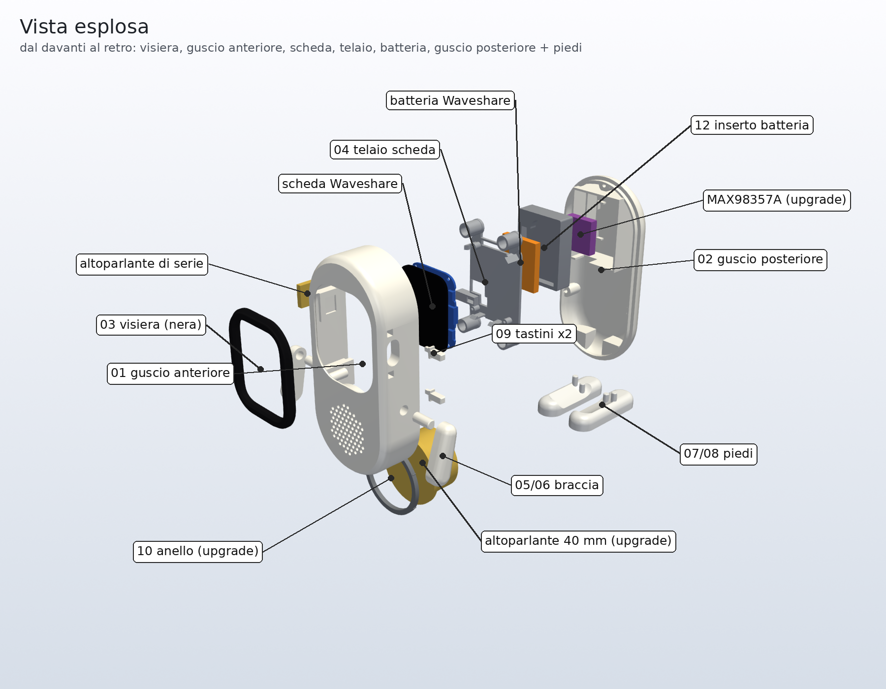

# Jarvis

*A tiny desk voice-assistant robot with animated AMOLED eyes, built on an ESP32-S3. Documentation in Italian.*

Assistente vocale da scrivania a forma di robottino. Ha due occhi animati su uno schermo AMOLED, risponde in italiano quando lo chiami «Jarvis», fa da orologio con il meteo e suona la radio. Gira su una **Waveshare ESP32-S3-Touch-AMOLED-1.8**: niente saldature e nessun costo ricorrente.

  
  

> **Stato:** prima versione (1.0.0). Il firmware compila senza warning, ma non è ancora stato collaudato sulla scheda: per il primo avvio c'è una checklist nella [specifica](docs/SPECIFICA.md#9-collaudo-al-primo-avvio).

## Cosa fa

- **«Jarvis» offline:** la parola di attivazione è riconosciuta sulla scheda (esp-sr di Espressif), senza mandare audio in rete finché non la dici.
- **Domande a voce:** trascrizione con Groq Whisper, risposta di un modello linguistico su Groq (Qwen 3.8, con riserva GPT-OSS), voce italiana di Azure con i **sottotitoli sincronizzati** sullo schermo.
- **Occhi animati** che ascoltano, pensano, sorridono quando parlano e sbattono le palpebre.
- **Orologio e meteo** (Open-Meteo) con la barra di stato del telefono: Wi-Fi, batteria, ricarica.
- **Radio via internet:** «Jarvis, metti Radio 105» (stream MP3 da radio-browser.info).
- **Touch:** un tocco cambia modalità o interrompe, un tocco lungo fa partire l'ascolto.
- **Pagina web** per Wi-Fi, chiavi, voce, volume, città e personalità. Configurazione dal telefono con captive portal; aggiornamenti del firmware via Wi-Fi.
- **Costi zero:** Groq e Azure Speech hanno piani gratuiti che bastano per l'uso domestico.

## Cosa serve

| | Prezzo indicativo |
|---|---|
| Waveshare ESP32-S3-Touch-AMOLED-1.8, versione **con batteria** (case nero, speaker e batteria inclusi) | circa 35–40 € |
| Cavo USB-C dati (va bene quello di un telefono) | – |
| Case a capsula stampato in 3D, facoltativo: PLA bianco e nero e 7 viti M2 × 8 | pochi euro |

Account gratuiti: [Groq](https://console.groq.com) e [Azure](https://portal.azure.com).

## Installazione

### 1. Caricare il firmware (senza installare nulla)

1. Scarica [`release/Jarvis_completo_0x0.bin`](release/Jarvis_completo_0x0.bin).
2. Collega la scheda al computer con il cavo USB-C e apri **https://espressif.github.io/esptool-js/** con Chrome o Edge.
3. Premi **Connect** e scegli la porta della scheda (USB JTAG/serial).
4. Premi **Erase Flash**: solo la prima volta.
5. In *Flash Address* lascia **0x0**, scegli il file `.bin` e premi **Program**.
6. Alla fine spegni e riaccendi la scheda: tieni PWR premuto 6 s, poi premilo di nuovo.

Se la scheda non viene riconosciuta: spegnila (PWR per 6 s), tieni premuto **BOOT** e riaccendila con PWR.

Al primo avvio Jarvis copia nella sua memoria il modello della parola di attivazione, in circa 3 secondi.

### 2. Procurarsi le chiavi (gratis)

- **Groq:** su https://console.groq.com, vai in *API Keys* e scegli *Create API Key*. Copia la chiave (inizia con `gsk_`).
- **Azure Speech:**
  1. Su https://portal.azure.com crea una risorsa **Speech** (Servizi di Voce).
  2. Come piano scegli **Free F0** e come area, per esempio, **West Europe**.
  3. Nella risorsa apri *Chiavi ed endpoint* e copia la *Chiave 1* e l'*Area* (es. `westeurope`).

### 3. Configurare Jarvis

1. Lo schermo mostra il nome di una rete Wi-Fi, `Jarvis-XXXX`: collegati con il telefono. Su molti telefoni la pagina si apre da sola; altrimenti vai su **http://192.168.4.1**.
2. Compila i campi e premi **Salva**:
   - rete Wi-Fi di casa e relativa password;
   - chiave Groq;
   - chiave e regione Azure;
   - città per il meteo;
   - una password per la pagina (consigliata).
3. Jarvis si riavvia e si collega a casa. Da lì in poi la pagina è su **http://jarvis.local** (oppure all'indirizzo che compare sullo schermo), con utente `admin` e la password scelta.

## Come si usa

| Gesto | Cosa succede |
|---|---|
| «Jarvis» | ti ascolta (in modalità assistente) |
| Tocco breve | assistente ↔ orologio; mentre parla, ascolta o suona la radio: la interrompe |
| Tocco lungo (1 s) | ti ascolta senza dire «Jarvis» |
| «Jarvis, metti la radio» | suona la radio preferita (Radio 105); si ferma con un tocco |
| PWR breve | standby; si risveglia con un tocco o con BOOT |
| PWR tenuto 6 s | spegnimento |
| BOOT breve | nuova conversazione |
| BOOT tenuto 5 s | torna alla configurazione (anche se hai dimenticato la password) |

**Aggiornamenti:** dalla pagina web, *Aggiornamento firmware (OTA)*, carica `release/Jarvis_aggiornamento_OTA.bin`.

## Il case

Corpo bianco a capsula con visiera nera, braccia in posa e piedini. Si stampa senza supporti su una stampante FDM qualsiasi e si chiude con 7 viti, senza saldature. È tutto parametrico (CadQuery).

  

- STL pronti per la stampa: [`case3d/stl/`](case3d/stl/).
- Istruzioni di stampa e montaggio: [`case3d/LEGGIMI_case.md`](case3d/LEGGIMI_case.md).
- Modello 3D interattivo: apri [`case3d/anteprima_3d.html`](case3d/anteprima_3d.html) nel browser, dopo averlo scaricato.

## Cartelle

| Cartella | Contenuto |
|---|---|
| [`firmware/Jarvis/`](firmware/Jarvis/) | sketch Arduino |
| [`firmware/COMPILAZIONE.md`](firmware/COMPILAZIONE.md) | come compilarlo (Arduino IDE 2 o arduino-cli) e generare i binari |
| [`release/`](release/) | binari pronti: installazione completa e aggiornamento OTA |
| [`case3d/`](case3d/) | case 3D: script, STL, STEP, anteprime |
| [`docs/SPECIFICA.md`](docs/SPECIFICA.md) | specifica tecnica: hardware, firmware, servizi, scelte e limiti |

## Limiti

- **Un solo microfono:** mentre parla o suona non sente «Jarvis», quindi si interrompe col tocco.
- **Autonomia:** con la batteria inclusa è breve (circa un'ora a schermo acceso). È pensata per stare sulla scrivania collegata alla USB.
- **Radio:** solo stream MP3. Radio Deejay e RTL 102.5 (canale principale) trasmettono solo in HLS/AAC.
- **Speaker:** quello di serie è piccolo. Lo speaker da 40 mm con MAX98357A è previsto nel case e nel firmware, ma richiede di saldare sul connettore di espansione.
- **Sicurezza:** pensata per una rete domestica. Le chiavi restano sulla scheda e la pagina non le mostra mai, ma il traffico verso la pagina non è cifrato.

## Licenza

Il codice e il case sono distribuiti con licenza [MIT](LICENSE). Il driver ES8311 e il modello «Jarvis» sono di Espressif e hanno le loro licenze: vedi [`LICENZE_TERZE_PARTI.md`](LICENZE_TERZE_PARTI.md).
