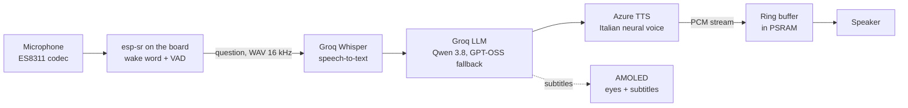

# Jarvis

*English · [Italiano](README.it.md)*

A tiny desk voice-assistant robot. It has two animated eyes on an AMOLED screen, answers in Italian when you call it "Jarvis", doubles as a clock with the weather and plays internet radio. It runs on a **Waveshare ESP32-S3-Touch-AMOLED-1.8**: no soldering and no running costs.

  
  

> **Status:** first release (1.0.0). The firmware builds with no warnings but has not been tested on the board yet. There is a first-boot checklist in the [spec](docs/SPECIFICA.md#9-collaudo-al-primo-avvio).

The assistant speaks Italian, and so do its configuration page and the detailed docs ([technical spec](docs/SPECIFICA.md), [build guide](firmware/COMPILAZIONE.md), [case assembly](case3d/LEGGIMI_case.md)).

## Features

- **Offline "Jarvis" wake word:** detected on the board with Espressif's esp-sr. No audio leaves the device until you say it.
- **Voice questions:** speech-to-text with Groq Whisper, answers from a language model on Groq (Qwen 3.8, falling back to GPT-OSS), and an Italian Azure voice with **synchronized subtitles** on the screen.
- **Animated eyes** that listen, think, smile while talking and blink.
- **Clock and weather** (Open-Meteo) with a phone-style status bar: Wi-Fi, battery, charging.
- **Internet radio:** "Jarvis, metti Radio 105" (MP3 stream found through radio-browser.info).
- **Touch:** a tap switches mode or interrupts, a long press starts listening.
- **Web page** for Wi-Fi, API keys, voice, volume, city and personality. Setup from your phone through a captive portal; firmware updates over Wi-Fi.
- **No running costs:** the free tiers of Groq and Azure Speech are enough for home use.

## How it works

- **Seven FreeRTOS tasks on both cores.** Core 0 only feeds the microphone to the audio front end and runs wake word detection and recording. Core 1 handles network, playback, UI, touch and the web page.
- **Recording:** after the beep, the first 250 ms (the beep's echo) are dropped and the VAD is reset. Recording stops after 700 ms of silence or 10 s, and is cancelled after 5 s without speech. The question is built in place in PSRAM and sent as a single multipart POST.
- **Fallbacks:** on errors, timeouts or rate limits, speech-to-text switches to the other Whisper model and the chat moves down a chain of three models. Typical Whisper hallucinations on silent audio are filtered out.
- **Playback:** Azure streams 16 kHz PCM straight into a lock-free single-producer, single-consumer ring buffer (576 KB in PSRAM, 3 s at 48 kHz), so no resampling is needed. The radio uses the same queue, with the codec switched to the stream's sample rate.

Design choices, pin map, partitions, the problems found during development and the known limits are in the [technical spec](docs/SPECIFICA.md).

## What you need

| | Approx. price |
|---|---|
| Waveshare ESP32-S3-Touch-AMOLED-1.8, **with battery** version (black case, speaker and battery included) | about €35–40 |
| USB-C data cable (a phone cable is fine) | – |
| 3D-printed capsule case, optional: white and black PLA and 7 M2 × 8 screws | a few euros |

Free accounts: [Groq](https://console.groq.com) and [Azure](https://portal.azure.com).

## Installation

### 1. Flash the firmware (nothing to install)

1. Download [`Jarvis_completo_0x0.bin`](https://github.com/skiokk/jarvis/releases/latest/download/Jarvis_completo_0x0.bin) from the [latest release](https://github.com/skiokk/jarvis/releases/latest).
2. Connect the board to your computer with the USB-C cable and open **https://espressif.github.io/esptool-js/** in Chrome or Edge.
3. Click **Connect** and pick the board's port (USB JTAG/serial).
4. Click **Erase Flash**: first time only.
5. Leave *Flash Address* at **0x0**, choose the `.bin` file and click **Program**.
6. When it's done, power-cycle the board: hold PWR for 6 s, then press it again.

If the board isn't detected: turn it off (PWR for 6 s), hold **BOOT** and turn it back on with PWR.

On first boot Jarvis copies the wake word model into its own partition, in about 3 seconds.

### 2. Get the API keys (free)

- **Groq:** at https://console.groq.com, go to *API Keys* and choose *Create API Key*. Copy the key (it starts with `gsk_`).
- **Azure Speech:**
  1. At https://portal.azure.com create a **Speech** resource.
  2. Choose the **Free F0** tier and a region, for example **West Europe**.
  3. In the resource, open *Keys and Endpoint* and copy *Key 1* and the *Location/Region* (e.g. `westeurope`).

### 3. Set up Jarvis

1. The screen shows the name of a Wi-Fi network, `Jarvis-XXXX`: connect to it with your phone. On many phones the page opens by itself; otherwise go to **http://192.168.4.1**.
2. Fill in the fields and press **Salva** (Save):
   - your home Wi-Fi network and password;
   - the Groq key;
   - the Azure key and region;
   - the city for the weather;
   - a password for the page (recommended).
3. Jarvis restarts and joins your network. From then on the page is at **http://jarvis.local** (or at the address shown on the screen), with user `admin` and the password you chose.

## Usage

| Gesture | What happens |
|---|---|
| "Jarvis" | listens (in assistant mode) |
| Short tap | assistant ↔ clock; while it's talking, listening or playing the radio: stops it |
| Long press (1 s) | listens without saying "Jarvis" |
| "Jarvis, metti la radio" | plays the favourite station (Radio 105); a tap stops it |
| Short PWR press | standby; wakes up with a tap or with BOOT |
| PWR held for 6 s | power off |
| Short BOOT press | new conversation |
| BOOT held for 5 s | back to setup (even if you forgot the password) |

**Updates:** on the web page, under *Aggiornamento firmware (OTA)*, upload `Jarvis_aggiornamento_OTA.bin` from the [latest release](https://github.com/skiokk/jarvis/releases/latest).

## The case

White capsule body with a black visor, posed arms and little feet. It prints without supports on any FDM printer and closes with 7 screws, no soldering. It is fully parametric (CadQuery).

  

- Print-ready STL files: [`case3d/stl/`](case3d/stl/).
- Printing and assembly instructions (Italian): [`case3d/LEGGIMI_case.md`](case3d/LEGGIMI_case.md).
- Interactive 3D model: download [`case3d/anteprima_3d.html`](case3d/anteprima_3d.html) and open it in a browser.

## Repository layout

| Folder | Contents |
|---|---|
| [`firmware/Jarvis/`](firmware/Jarvis/) | Arduino sketch |
| [`firmware/COMPILAZIONE.md`](firmware/COMPILAZIONE.md) | how to build it (Arduino IDE 2 or arduino-cli) and produce the binaries |
| [`case3d/`](case3d/) | 3D case: scripts, STL, STEP, previews |
| [`docs/SPECIFICA.md`](docs/SPECIFICA.md) | technical spec: hardware, firmware, services, choices and limits |

The ready-made binaries (full image and OTA update) are on the [Releases](https://github.com/skiokk/jarvis/releases) page.

## Limitations

- **One microphone:** while Jarvis is talking or playing it can't hear "Jarvis", so you interrupt it with a tap.
- **Battery life:** short with the included battery (about an hour with the screen on). It's meant to sit on the desk, plugged into USB.
- **Radio:** MP3 streams only. Radio Deejay and RTL 102.5 (main channel) only broadcast in HLS/AAC.
- **Speaker:** the built-in one is small. A 40 mm speaker with a MAX98357A is already supported by the case and the firmware, but it needs soldering on the expansion header.
- **Security:** designed for a home network. The keys stay on the board and the page never shows them, but traffic to the page is not encrypted.

## License

The code and the case are released under the [MIT](LICENSE) license. The ES8311 driver and the "Jarvis" wake word model are by Espressif and have their own licenses: see [`LICENZE_TERZE_PARTI.md`](LICENZE_TERZE_PARTI.md).
