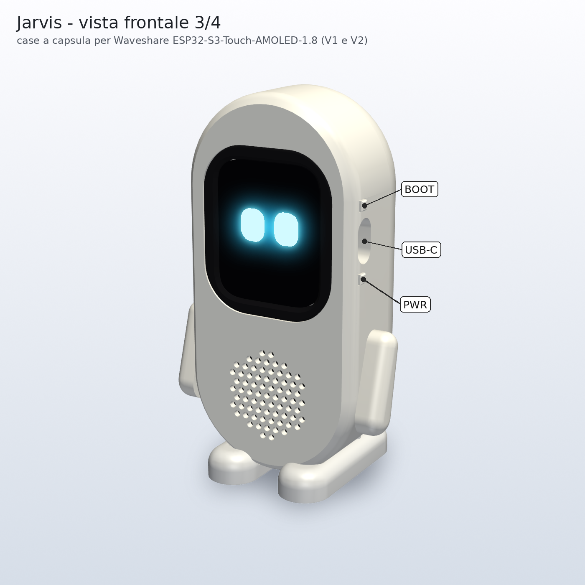

# Jarvis: case 3D "robottino a capsula"

Case stampabile per la **Waveshare ESP32-S3-Touch-AMOLED-1.8**, revisioni **V1** (SH8601 + FT3168) e **V2** (CO5300 + CST820).
È un corpo bianco a capsula con visiera nera. Il display AMOLED disegna gli occhi luminosi sul nero vero.
Ha braccine e piedini a incastro. Si monta senza saldature: 7 viti M2 autofilettanti, nessuna colla obbligatoria.



| Ingombri | |
|---|---|
| Corpo | 56 × 114 × 35,5 mm (larghezza × altezza × profondità) |
| Con piedi e braccia | alto 117,5 mm, largo 71 mm, profondo 53 mm |
| Batteria | quella **fornita con la scheda Waveshare** (circa 3,85 × 24 × 28 mm, spina MX1.25 già giusta), tenuta dall'inserto `12`. Il vano accetta anche una **LiPo 103040** (10 × 30 × 40 mm, circa 1200 mAh) senza inserto |
| Plastica totale | circa 95 g a pezzo pieno; in pratica 65–75 g, quasi tutta bianca. Visiera nera circa 3 g |

Anteprime: `anteprime/*.png`. Modello interattivo: apri `anteprima_3d.html` con il browser.
Funziona anche da file. Serve internet solo per scaricare three.js.
Opzioni nell'indirizzo: `#esplosa`, `#componenti`, `#sezione`.

---

## 1. Elenco parti

Tutti gli STL in `stl/` sono **già orientati per la stampa**: faccia piatta sul piatto, **nessun supporto**.
Vedi `anteprime/06_parti_orientate_per_la_stampa.png`.

| File | Q.tà | Filamento | Sul piatto | Note |
|---|---|---|---|---|
| `00_prova_misure.stl` | 1 | qualsiasi | piastra in basso | **Da stampare per primo** (circa 4 g, vedi §5) |
| `01_guscio_anteriore.stl` | 1 | **bianco** | faccia frontale | Parete 2 mm. Contiene griglia, sede visiera, colonnine, guide USB e tastini, tasca dell'altoparlante, condotto del microfono |
| `02_guscio_posteriore.stl` | 1 | **bianco** | schiena | Vano batteria, angolari per il MAX98357A, torrette delle viti, sedi dei piedi, scritta "JARVIS" |
| `03_visiera.stl` | 1 | **nero** (opaco o lucido) | faccia frontale | Lascia scoperto tutto il vetro, con 0,25 mm di gioco e uno smusso a 45° |
| `04_telaio_scheda.stl` | 1 | grigio/qualsiasi (meglio **PETG**) | piastra | 4 appoggi con perno nei fori M2 e 4 ganci elastici che trattengono il PCB |
| `05_braccio_destro.stl`, `06_braccio_sinistro.stl` | 1+1 | bianco | faccia piatta interna | Foro cieco per il perno |
| `07_piede_destro.stl`, `08_piede_sinistro.stl` | 1+1 | bianco o grigio chiaro | suola | 2 pioli ciascuno. Il tallone sporge dietro per la stabilità |
| `09_tastino.stl` | **2** | bianco | sdraiato | Uno per BOOT (in alto), uno per PWR (in basso): sono identici |
| `10_anello_altoparlante40.stl` | 1 | qualsiasi | piatto | **Solo per l'upgrade** con l'altoparlante da 40 mm |
| `11_perno_braccio.stl` | **2** | bianco (meglio PETG) | sulla parte piatta | Perno a D. Stretto nel braccio, gira con attrito nel corpo: le braccia si mettono in posa |
| `12_inserto_batteria_waveshare.stl` | 1 | qualsiasi | retro, tasca in alto | Riempie il vano della 103040 e tiene ferma la batteria Waveshare, con canale per il cavo e incavo per il dito. **Non serve** se usi una 103040 |

`stl/montaggio/` contiene gli stessi pezzi **in posizione di montaggio**, più gli ingombri di riferimento: scheda, vetro, batteria, altoparlanti e MAX98357A.
Servono per le anteprime: **non stamparli**.
`jarvis_assemblato.step` è l'assieme completo con i colori, da aprire in FreeCAD, Fusion o simili.

## 2. Impostazioni di stampa

Il case è pensato per una stampante FDM standard: il pezzo più grande è 56 × 114 mm. Ugello 0,4.

| | Gusci 01-02 | Visiera 03 | Telaio 04 e perni 11 | Piedi 07-08 | Braccia, tastini, anello, prova |
|---|---|---|---|---|---|
| Materiale | PLA (o PLA+, PETG) | PLA nero | **PETG** consigliato (i ganci flettono), PLA va bene | PLA | PLA |
| Altezza strato | 0,2 mm | 0,16 mm | 0,16–0,2 mm | 0,2 mm | 0,16–0,2 mm |
| Perimetri | **5** (parete da 2 mm piena) | 4 | 4 | 4 | 3–4 |
| Strati sopra/sotto | 5 / 5 | 5 / 5 | 5 / 5 | 5 / 5 | 5 / 5 |
| Riempimento | 20 % gyroid | 30 % | 40 % | **100 %** (peso = stabilità) | 30 % |
| Supporti | **NO** | **NO** | **NO** | **NO** | **NO** |
| Note | cucitura "dietro"; piatto PEI liscio = fronte lucido, texturizzato = opaco | compensazione "piede d'elefante" circa 0,15 mm (entra nell'apertura) | | | brim per tastini e perni se aderiscono poco |

Dettagli sulla stampabilità, verificata sugli STL (sbalzi oltre 45° misurati faccia per faccia):

- **Raccordi dei gusci sul piatto.** Dove il bordo arrotondato tocca il piatto lo script aggiunge una sottile fascia a 45° tangente al raccordo.
  Si vede appena e toglie lo sbalzo quasi orizzontale dei primi millimetri.
  Ciò che resta oltre 50° sono solo piccoli "ponti": il tetto dei fori orizzontali (USB, tastini, perni), le lettere incise e le sedi delle teste delle viti.
- **Interno.** Colonnine, torrette e nervature nascono tutte dal piatto o sono smussate a 45°.
- **Visiera e telaio.** La spalla della visiera è a 45°. Il dente dei ganci del telaio sporge solo 0,6 mm.

## 3. Materiale da comprare

| Cosa | Q.tà | Note |
|---|---|---|
| Vite autofilettante per plastica **M2 × 8** a testa bombata o cilindrica (vanno bene anche M2 × 10) | **7** | 4 fissano il telaio, 3 chiudono i gusci (testa del robot + spalle) |
| Batteria | 1 | Quella fornita con la scheda (versione "con batteria"). In alternativa una LiPo 3,7 V **103040** con protezione (PCM) e spina **MX1.25 a 2 poli**: **controlla la polarità prima di collegarla** (vedi §4, passo 6) |
| Facoltativi | | spessore in gommapiuma da 1 mm (se la batteria balla), piedini antiscivolo adesivi, biadesivo (per il MAX98357A), feltro nero Ø 32 mm dietro la griglia (se non monti l'altoparlante da 40 mm) |

Non servono **magneti** né inserti filettati.
Niente metallo vicino all'antenna: la vite più vicina è a 10,9 mm dal chip d'antenna (distanza calcolata dallo script, in `stl/verifica.json`).
**Non usare filamenti caricati** con carbonio o metallo per guscio anteriore, visiera e telaio.

## 4. Montaggio, passo per passo

Prima di cominciare, stampa e prova il pezzo `00_prova_misure` (§5).

1. **Pulizia.** Togli fili e bave. Prova i 2 tastini nelle guide quadre sul fianco destro: devono scorrere liberi.
   Prova i perni nei fori dei bracci: devono entrare stretti.
2. **Visiera.** Appoggia il guscio anteriore a faccia in giù su un panno.
   Infila la visiera **da dentro**: la spalla a 45° si centra da sola nello smusso dell'apertura.
3. **Tastini.** Infila da dentro i due tastini nelle guide quadre, con la flangia larga verso l'interno e la punta sottile verso il centro.
   Quello in alto è BOOT, quello in basso è PWR.
4. **Altoparlante di serie** (12 × 10 mm, appeso ai fili della scheda). Fallo scivolare nella tasca sul fianco sinistro, con la membrana verso le feritoie e i fili verso l'interno.
   Se i fili sono troppo corti, lascialo nella finestra del PCB come nel case Waveshare (spazio libero, vedi §6).
5. **Scheda nel telaio.** Appoggia il telaio con la piastra in basso.
   Spingi la scheda (vetro verso l'alto) finché i **4 ganci** fanno clic sul bordo del PCB e i 4 perni entrano nei fori M2.
   Spingi in modo uniforme con due pollici sul vetro. Se i ganci sono duri, allargali appena con l'unghia.
6. **Batteria.** Collegala ora, che il connettore è comodo. La spina entra dal basso verso l'alto nel connettore sul retro della scheda, a sinistra guardando il display.
   **Polarità:** con la batteria fornita da Waveshare è già giusta. Con un'altra batteria controlla col tester: secondo lo schema Waveshare il pin 1 = **+** è quello verso il centro della scheda (serigrafia "+"), e le spine 1,25 mm di marche diverse possono avere i fili invertiti.
   Fai passare i fili nell'apertura del telaio accanto al condotto del microfono, dal lato verso il centro della scheda.
7. **Telaio nel guscio.** Infila il gruppo telaio + scheda nel guscio anteriore: i 4 tubi del telaio scendono sulle 4 colonnine e il vetro entra nella visiera.
   Avvita le **4 viti M2 × 8**, senza stringere troppo: è plastica.
   I fori del telaio hanno un po' di gioco, così il vetro si centra da solo nella visiera. Il vetro deve restare circa 1 mm sotto la superficie della visiera.
8. **Prova di accensione** prima di chiudere: tasto PWR, display, tocco, ricarica dalla USB-C.
9. **Upgrade, facoltativo.** Metti l'altoparlante da 40 mm nel collare dietro la griglia e bloccalo spingendo l'anello `10` a pressione.
   Fissa la schedina MAX98357A tra gli angolari dietro la batteria, con il biadesivo. Il connettore a 15 pin ha passo 1,27 mm: **serve saldare**.
10. **Batteria nel vano** del guscio posteriore.
    - Con la **batteria Waveshare**: metti l'inserto `12` nel vano, con la tasca verso di te (verso la scheda) e il canale del cavo in basso, dove il vano ha la finestra. Appoggia la batteria nella tasca e fai uscire il cavo dal canale.
    - Con una **103040**: niente inserto, batteria direttamente nel vano con i fili verso il basso.

    Ripiega il cavo in avanzo nello spazio libero accanto alla batteria.
11. **Chiusura.** Avvicina il guscio posteriore: il bordo di centraggio entra nel guscio anteriore.
    Controlla che nessun filo resti schiacciato. Avvita le **3 viti M2 × 8** da dietro: una in cima alla testa, due sulle spalle.
12. **Piedi.** Spingi i 2 pioli di ogni piede nei fori sotto il guscio posteriore, con il tallone verso il retro.
    **Braccia:** prima il perno nel braccio, poi il perno nel foro sul fianco. Ruota le braccia per metterle in posa.

**Uso al tocco.** Il robot è leggero (circa 105 g). Premendo il centro dello schermo si ribalta all'indietro con circa **0,4 N**, cioè circa 41 g di forza; con l'altoparlante da 40 mm circa 0,53 N.
Un tocco leggero va bene. Per il **tocco lungo** (1 s) tieni un dito dietro la testa, oppure usa la parola «Jarvis».
Aiutano anche i piedini antiscivolo e i piedi stampati al 100 %.

## 5. Misure da verificare prima di stampare tutto

Le misure della scheda vengono dal **modello STEP ufficiale Waveshare**: scheda **V1**, CREO, 2025-03-04.
Il case è stato controllato contro quel modello: nessuna compenetrazione. Gioco minimo vetro-visiera 0,235 mm; tastini a 0,15 mm dai pulsantini; il telaio tocca solo le facce del PCB.
**Non esiste uno STEP della V2.** Le foto Waveshare mostrano lo stesso layout, ma le differenze meccaniche V1/V2 **non sono verificate**.

Il pezzo **`00_prova_misure`** (circa 20 minuti) serve proprio a questo. Controlla:

1. la scheda si aggancia nei 4 ganci e appoggia piatta sui 4 perni, senza gioco e senza forzare;
2. a scheda agganciata, la **presa USB-C** è centrata nell'asola del blocco laterale e un cavo entra fino in fondo;
3. le guide quadre dei tastini sono in linea con i pulsantini BOOT e PWR (con i tastini infilati, si sente il clic);
4. il **vetro** entra nell'anello di prova (stessa apertura della visiera) con un filo di gioco su tutti i lati.

Misure **STIMATE**, cioè non presenti nel modello STEP o non verificabili da qui:

| Cosa | Valore usato | Dove si cambia | Come verificare |
|---|---|---|---|
| Altoparlante di serie | 12 × 10 × **3** mm; lunghezza dei fili ignota | `SPK_PICCOLO`, `SPK_PICCOLO_Y` | misurarlo |
| Spina del cavo USB-C | plastica fino a circa **12,8 × 7 mm**, parte metallica circa 6,6 mm | `USB_SPINA` | pezzo di prova, punto 2. I cavi con la spina molto grossa possono non entrare fino in fondo |
| Porta del microfono | verso il retro (MEMS sul retro del PCB) + foro laterale come nel case Waveshare | `MIC_Y`, `MIC_FORO_Z` | prova «Jarvis» a 1–2 m |
| Corsa dei pulsantini TS24CA | circa 0,25 mm; il tastino parte a 0,15 mm | `TASTO_X_PUNTA` | pezzo di prova, punto 3 |
| Altoparlante 40 mm | Ø 40 × 20 mm (dati Adafruit 3968); flangia 2,5 mm e cestello ≤ Ø 34 mm stimati | `ALTOP_*`, `ANELLO_D_INT` | misurare il modello comprato |
| Batteria Waveshare | 3,85 × 24 × 28 mm (formato consigliato da Waveshare per il suo case) + 0,4 mm di gioco | `BATT_WS_*` | misurarla appena arriva; se è diversa cambia i tre valori e rigenera l'inserto |
| Batteria 103040 | 10 × 30 × 40 mm + 0,5 mm di gioco; alcune sono spesse 10,5 mm o hanno il PCM sporgente | `BATT_*` | misurarla; se balla, gommapiuma |
| MAX98357A | 18 × 20 × 5 mm con i fili | `MAX_DIM` | misurarla |
| Adesivo tra pannello e PCB | si presume il pannello incollato con biadesivo in schiuma (nel modello STEP non c'è) | | se il vetro "galleggia", non forzare: il case trattiene il PCB, il vetro è libero nella visiera |
| Antenna | chip sul bordo inferiore (x da −5,2 a 2,5 mm), posizione dedotta dalle foto | `ANTENNA` | |

Distanze dall'antenna calcolate in 3D dallo script: vite più vicina 10,9 mm, batteria Waveshare 11,9 mm (una 103040 starebbe a 9,8 mm).
L'altoparlante da 40 mm (solo upgrade) resta a 9,5 mm: possibile lieve calo del Wi-Fi.

## 6. Note di progetto

- **Vetro scoperto.** L'apertura della visiera segue il contorno reale del vetro (estratto dallo STEP), + 0,25 mm.
  Nessun bordo copre il vetro o l'area attiva. Il vetro è 1 mm sotto la superficie con uno smusso a 45°, così si tocca bene anche ai bordi.
  Il PCB è tenuto da 4 ganci sul bordo anteriore e da 4 appoggi con perno nei fori M2. Il PCB non si avvita: davanti c'è il pannello.
- **Tasti.** PWR non può risvegliare l'ESP32 dal deep sleep, perché la linea INT dell'espansore non è collegata: il case non cambia questo.
  Il tastino PWR serve per accendere, spegnere (6 s) e andare in standby.
- **microSD.** Non è accessibile da fuori: il firmware non la usa.
- **Finestra del PCB in alto a sinistra.** È libera fra pannello e telaio: può ospitare l'altoparlante di serie se i fili non arrivano alla tasca laterale. Si fissa con un pezzetto di biadesivo.
- **Connettore a 15 pin.** C'è una feritoia nel telaio, sotto i fori, per far passare i fili dell'upgrade.

## 7. Cambiare le misure e rigenerare

Tutte le misure principali sono nella sezione **PARAMETRI**, in cima a `jarvis_case.py`, con commenti in italiano.
Tra le altre: tolleranze `GIOCO` e `GIOCO_INCASTRO`, dimensioni del corpo, visiera, batteria (`BATT_*` per il vano, `BATT_WS_*` e `USA_BATTERIA_WAVESHARE` per l'inserto), altoparlanti, braccia e piedi, scritta `TESTO_RETRO` (`""` per toglierla) e fasce di stampa `SMUSSO_STAMPA_*`.

Serve Python 3 con CadQuery. La prima volta crea un ambiente:

```bash
python3 -m venv ~/venv-cad
~/venv-cad/bin/pip install cadquery trimesh manifold3d vtk pillow numpy
```

Poi, nella cartella `case3d`:

```bash
~/venv-cad/bin/python jarvis_case.py   # STL in stl/, STEP, verifica mesh e interferenze (circa 30 s)
~/venv-cad/bin/python anteprime.py         # immagini in anteprime/ (serve un display grafico)
~/venv-cad/bin/python genera_html.py       # aggiorna anteprima_3d.html
```

`jarvis_case.py` stampa per ogni STL: chiuso (watertight), manifold, volume e ingombro.
Poi controlla le interferenze fra le parti montate e stima la stabilità al tocco. Il riassunto finisce in `stl/verifica.json`.
Se le prove dicono che è tutto troppo stretto o troppo largo, cambia soprattutto `GIOCO` (vetro e scheda) e `GIOCO_INCASTRO` (parti stampate fra loro), poi rigenera.

## 8. Verifiche eseguite (11 ottobre 2026)

- 13 STL, tutti **chiusi e manifold**: trimesh `is_watertight` e manifold3d `NoError`, un solo corpo ciascuno.
- **Nessuna interferenza** fra le parti montate e con gli ingombri di riferimento. Uniche eccezioni volute: le nervature schiacciabili dell'anello e il perno nel foro del braccio.
- Controllo contro i **315.000 punti del modello STEP ufficiale**, compresi i componenti SMD: **0 punti** dentro le parti stampate, e nessun punto delle parti dentro i solidi della scheda.
- Sbalzi oltre 50° solo su piccoli ponti: **nessun supporto necessario**.
- Stabilità stimata con la batteria Waveshare: 104,8 g, baricentro a z = −14,3 mm. Forza di ribaltamento al centro dello schermo 0,41 N (0,53 N con l'altoparlante da 40 mm).
- Distanza dalla zona dell'antenna: viti ≥ 10,9 mm, batteria Waveshare 11,9 mm (103040: 9,8 mm), altoparlante da 40 mm 9,5 mm.

## 9. File

| File | Contenuto |
|---|---|
| `jarvis_case.py` | modello parametrico CadQuery, esportazione e verifiche |
| `anteprime.py`, `anteprime/*.png` | immagini: 3/4 frontale, 3/4 posteriore, esploso, sezione, aspetto finale con gli occhi, parti sul piatto |
| `genera_html.py`, `anteprima_3d.html` | visualizzatore 3D interattivo (three.js 0.160.0, STL incorporati) |
| `stl/*.stl` | parti da stampare, già orientate |
| `stl/montaggio/*.stl` | parti in posizione di montaggio + riferimenti (non stampare) |
| `stl/verifica.json` | risultati delle verifiche |
| `jarvis_assemblato.step` | assieme completo |
